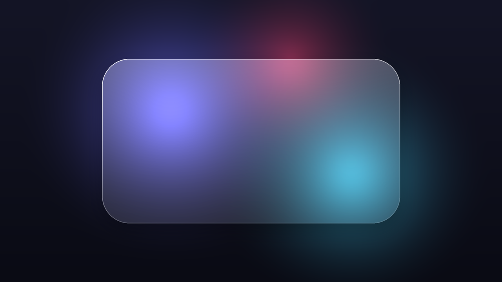
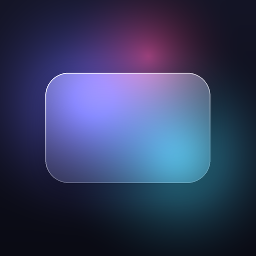
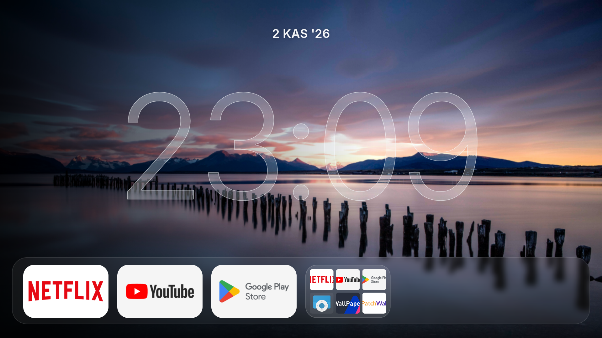
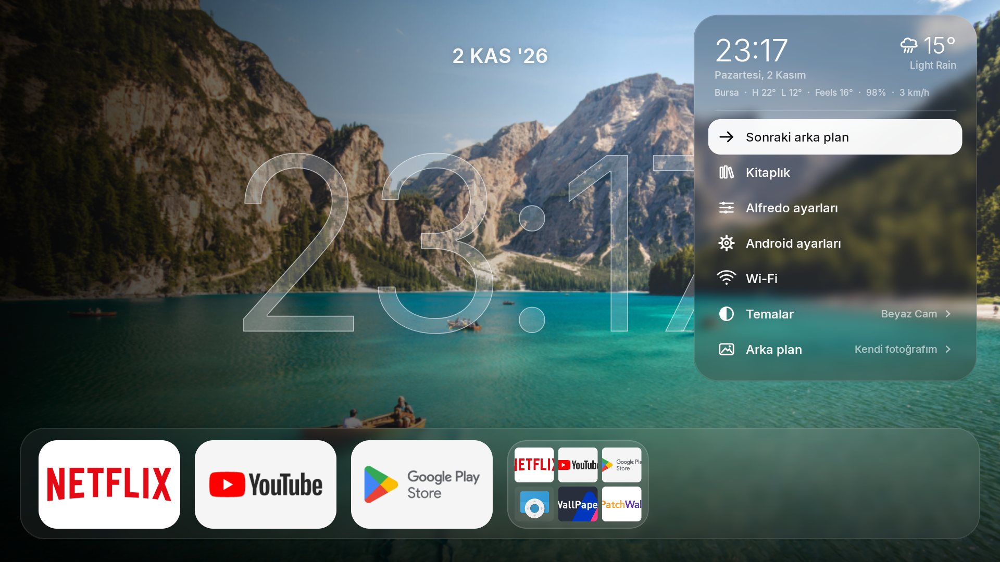
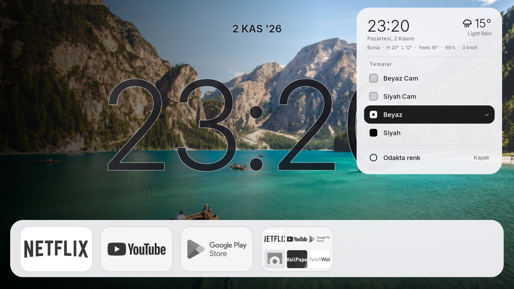
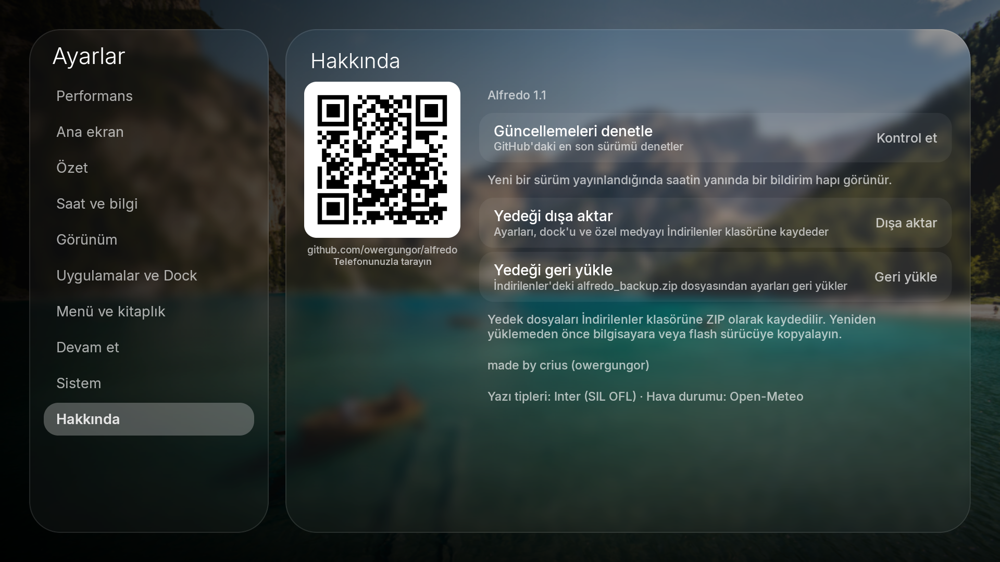

<p align="center">
  
</p>

<p align="center">
  
</p>

<h1 align="center">Alfredo</h1>

<p align="center">
  <strong>A refined, glass-inspired launcher for Android TV.</strong><br>
  Built for a fluid, aesthetic, and clutter-free television experience.
</p>

<p align="center">
  <a href="https://github.com/owergungor/alfredo/releases/latest"></a>
  <a href="https://developer.android.com/about/versions/oreo"></a>
  <a href="https://github.com/owergungor/alfredo/releases"></a>
  <a href="LICENSE"></a>
</p>

<p align="center">
  <strong><a href="README.md">English</a></strong> •
  <strong><a href="README.tr.md">Türkçe</a></strong> •
  <strong><a href="docs/README.ar.md">العربية</a></strong>
</p>

---

## 1. Product Introduction

**Alfredo** is a lightweight, high-performance Android TV launcher developed with Jetpack Compose. Inspired by cinematic glass interfaces, Alfredo blends translucent frosted aesthetics with lightning-fast navigation, low-memory optimization, and TV remote-friendly ergonomics.

Whether running on flagship Google TV sets or memory-constrained streaming dongles such as the **Xiaomi Mi TV Stick (1 GB RAM / Android 9)**, Alfredo starts quickly, prioritizes your wallpaper, and keeps your television interface clean and responsive.

Alfredo is an independent continuation and optimized fork of the open-source launcher codebase originally created as Glassio by [Mohmmad (mrh12)](https://github.com/mohammadmrh12).

---

## 2. Download Alfredo

Get the latest official, production-signed release APK directly from GitHub:

<p align="center">
  <a href="https://github.com/owergungor/alfredo/releases/download/v1.1/Alfredo-v1.1.apk">
    
  </a>
</p>

| Package | Version | VersionCode | Package Name | SHA-256 Checksum |
| :--- | :--- | :--- | :--- | :--- |
| **[Alfredo-v1.1.apk](https://github.com/owergungor/alfredo/releases/download/v1.1/Alfredo-v1.1.apk)** | `1.1` | `32` | `com.glasslauncher.tv.devtest` | `F63E136CF6221DEEF765659169D2FA61013F96FDF5BE3BC633A35EB6F77AAB26` |

> [!NOTE]
> All official releases are signed with our dedicated production key:
> `CN=Alfredo Launcher, OU=Release, O=Alfredo, C=TR`
> SHA-256 Fingerprint: `5eebd507a890e4f855b1f9831014d1edd6e94312f53225b7d8381fed32de40c5`

---

## 3. Features

- **Liquid-Glass Aesthetics**: Real-time translucent panels, refined frosted dock contours, specular highlights, and ambient clock typography.
- **Background-First Startup**: Immediate wallpaper display on launch; UI components load asynchronously without jarring black frames.
- **Harmonized Canonical Themes**: Four unified looks:
  - **Beyaz Cam** *(Frosted White Glass)*
  - **Siyah Cam** *(Tinted Black Glass)*
  - **Beyaz** *(High-contrast light appearance with slate ink numerals)*
  - **Siyah** *(Pure AMOLED black dock with crisp rim clock)*
- **TV Remote Navigation**: First-class D-Pad navigation with fluid animations, intuitive edge bounding, and focused feedback.
- **Customizable App Dock & Folders**: Pin favorites, organize applications into folders, adjust dock scale, and hide system apps.
- **Built-in Local Library & Trakt Sync**: Track movies and series locally or connect your Trakt account without TV keyboard password entry.
- **Native Bilingual Support**: Complete Turkish and English interfaces with natural localization across every setting.
- **Hardened ZIP Backup & Restore**: Export all SharedPreferences, custom backgrounds, and icons into an integrity-checked, SHA-256-verified archive.
- **Home Button Interception**: Optional accessibility service integration to reliably bring you back to Alfredo when pressing your TV remote's Home button.
- **Low-RAM Guard Architecture**: Active memory bounding, bitmap recycling, and cold-cache acceleration built for 1 GB RAM Android TV hardware.

---

## 4. Visual Showcase

<p align="center">
  
  
</p>
<p align="center">
  
  
</p>

---

## 5. Installation Guide

You can install Alfredo onto your Android TV or Google TV device using any of the methods below:

### Method A: Direct Install via Android TV Downloader (Recommended)
1. Install the free **Downloader by AFTVnews** app from the Google Play Store on your TV.
2. Open Downloader, allow storage permissions, and enter the short URL or direct link:
   ```text
   https://github.com/owergungor/alfredo/releases/download/v1.1/Alfredo-v1.1.apk
   ```
3. Once downloaded, click **Install**.
4. If prompted with *"Unknown Apps"*, open TV **Settings → Security & Restrictions → Install Unknown Apps**, allow Downloader, and proceed with the installation.

### Method B: USB Flash Drive / File Manager
1. Download `Alfredo-v1.1.apk` on your computer.
2. Copy the file onto a FAT32/exFAT-formatted USB drive.
3. Plug the drive into your Android TV or box.
4. Using any TV file manager (e.g., *X-plore*, *File Commander*), locate `Alfredo-v1.1.apk` and select **Install**.

### Method C: Installation via ADB (Command Line)
Enable **Developer Options** and **USB Debugging / Network Debugging** on your TV, then run from your terminal:

```bash
# Connect to your television via local Wi-Fi IP
adb connect 192.168.1.XX:5555

# Install or update without losing user data (-r)
adb install -r Alfredo-v1.1.apk
```

> [!WARNING]
> **Data Preservation**: Do NOT uninstall your previous version if you want to keep your custom wallpapers, folders, and dock arrangements. Installing with `-r` (or over the existing app) safely updates the binary while preserving all configurations.

---

## 6. Android TV & Mi TV Stick Setup

Alfredo is tested on memory-constrained devices like the **Xiaomi Mi TV Stick (MiTV-AESP0, codename `aquaman`)**:

1. **Performance Mode**: By default, Alfredo automatically selects *Quality* or *Balanced* rendering based on hardware capability. On low-RAM devices, hardware bitmap acceleration and memory caches are tuned to keep PSS usage below **65 MB**.
2. **Smooth Animations**: Transitions run on hardware-interpolated Compose choreographers without blocking the main render loop.
3. **Background Media**: Local image backgrounds are cached in memory-efficient formats to eliminate frame skips when returning from video apps.

---

## 7. Compatibility & Requirements

| Specification | Requirement |
| :--- | :--- |
| **Minimum Android Version** | Android 8.0 Oreo (API level 26) |
| **Target Android Version** | Android 15 (API level 35) |
| **Tested Target Devices** | Xiaomi Mi TV Stick (Android 9 / API 28), Google TV Chromecast (Android 12/14) |
| **Supported ABIs** | `armeabi-v7a` (32-bit), `arm64-v8a` (64-bit), `x86`, `x86_64` |
| **Memory Footprint** | ~55–65 MB PSS (under 1 GB total RAM devices) |
| **Input Device** | Standard Android TV D-Pad Remote Control |

---

## 8. Themes & Customization

Alfredo provides four canonical appearance themes accessible directly from **Side Menu → Themes** or **Settings → Appearance**:

| Theme | Appearance | Highlights |
| :--- | :--- | :--- |
| **Beyaz Cam** *(Default)* | Translucent White Glass | Soft specular edges, dynamic blurred background blending |
| **Siyah Cam** | Translucent Dark Glass | Subtle tinted glass, cinematic evening aesthetic |
| **Beyaz** | High-Contrast Light | Solid crisp dock, deep slate ink clock numerals for bright rooms |
| **Siyah** | Deep AMOLED Black | Solid black dock (`#000000`), fine white outline clock, minimal power |

Switching any theme automatically synchronizes the dock plate, tile icons, side drawer, settings panels, and ambient clock with zero restart required.

---

## 9. Backup & Restore

All configuration data in Alfredo is user-owned and easily portable:
- **Location**: Navigate to **Settings → About**.
- **Export Backup**: Saves an encrypted-integrity ZIP archive to your TV's `Download/alfredo_backup.zip`, containing your dock layout, custom folder structures, hidden apps, SharedPreferences, and custom background media.
- **Integrity**: Every backup generates a companion `.sha256` checksum file to guarantee data integrity against corrupted storage.
- **Restore Backup**: Safely validates archive versioning, bounds extraction within strict quotas (protection against Zip-Slip), and restores your launcher preferences in one click.

---

## 10. Home Launcher / Default Launcher Notes

To set Alfredo as your primary launcher:
1. Open TV **Settings → Apps → Default Apps → Home app**, and select **Alfredo**.
2. **Home Button Interception**: Some TV sticks (including certain Xiaomi / Google TV firmware) hardcode the remote Home button to the stock vendor dashboard.
   - Alfredo includes an optional, zero-overhead accessibility service.
   - Go to **Settings → System** inside Alfredo and enable **"Open Alfredo on Home button"**.
   - Enable the Alfredo accessibility service when prompted. Pressing Home will now immediately bring you back to Alfredo.

---

## 11. Troubleshooting

- **App crashes or fails to install over an existing version**:
  Ensure you are updating an official build. Conflicting debug signatures will reject updates. Official updates share the production signature `5eebd507a890...`.
- **Weather is blank**:
  Verify your TV has internet connectivity. Alfredo queries open-source weather feeds (Open-Meteo) based on your approximate coarse network location.
- **Home button returns to stock interface**:
  Make sure Alfredo's Accessibility Service is enabled in **Settings → System → Accessibility**.

---

## 12. Frequently Asked Questions (FAQ)

<details>
<summary><strong>Does Alfredo contain advertisements or telemetry?</strong></summary>
No. Alfredo is 100% open-source, contains zero tracking SDKs, zero advertising networks, and no external analytics.
</details>

<details>
<summary><strong>Why is the package name <code>com.glasslauncher.tv.devtest</code>?</strong></summary>
This application ID is intentionally preserved from the upstream lineage so that existing users can seamlessly update via APK without losing their arranged docks, icon packs, and custom wallpapers.
</details>

<details>
<summary><strong>Can I use my own custom wallpapers and icon packs?</strong></summary>
Yes. In <strong>Settings → Appearance</strong>, you can select custom wallpapers from local TV folders, enter remote image URLs, or enable the dynamic cycling carousel.
</details>

---

## 13. Contributing

Contributions are welcome! Please read our [Contributing Guidelines](CONTRIBUTING.md) and [Code of Conduct](CODE_OF_CONDUCT.md) before submitting pull requests.

To build locally from source:
```bash
git clone https://github.com/owergungor/alfredo.git
cd alfredo
./gradlew assembleDebug
```

---

## 14. License

Alfredo is licensed under the **GNU General Public License v3.0 (GPL-3.0)**.
See the full text in [LICENSE](LICENSE).

---

## 15. Security

We take the security of our users seriously. If you discover a vulnerability or security issue, please review our [Security Policy](SECURITY.md) to report it responsibly.

---

## 16. Credits & Attribution

- **Maintainer & Enhancements**: `crius` ([@owergungor](https://github.com/owergungor))
- **Original Project**: Created as *Glassio* by [Mohmmad (mrh12)](https://github.com/mohammadmrh12).
- **Typography**: [Inter](https://rsms.me/inter/) font family by Rasmus Andersson (SIL Open Font License).
- **Weather Data**: Powered by [Open-Meteo](https://open-meteo.com/).
- **Clock Glass Concept**: Visual approach inspired by Seagey's [Couch-TV](https://github.com/Seagey/couch-tv) (MIT License, see [docs/CLOCK-GLASS-ATTRIBUTION.md](docs/CLOCK-GLASS-ATTRIBUTION.md)).
