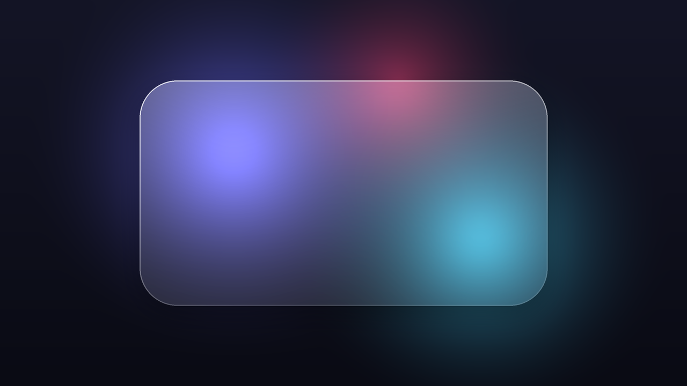
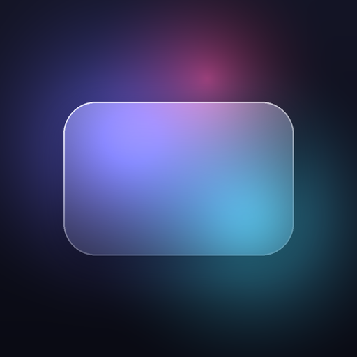
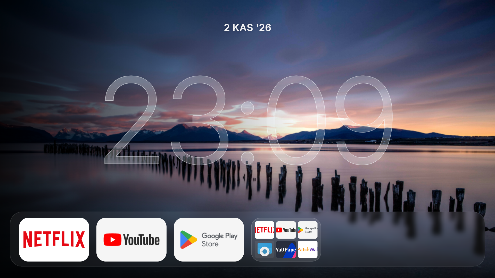
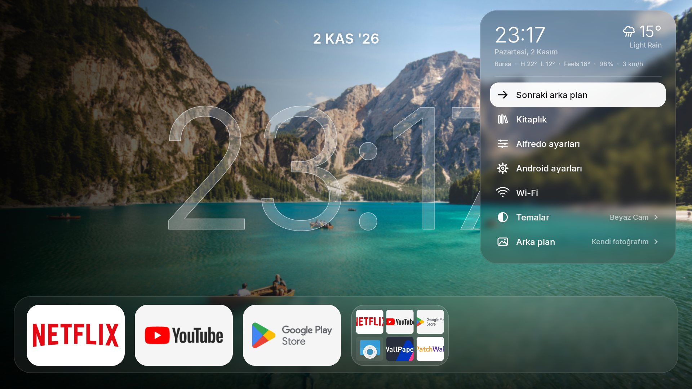
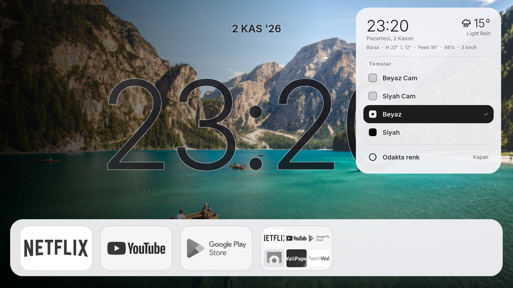
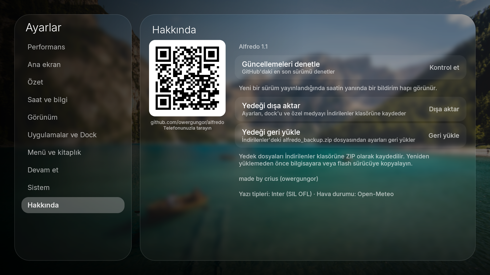

<p align="center">
  
</p>

<p align="center">
  
</p>

<h1 align="center">Alfredo</h1>

<p align="center">
  <strong>Android TV için geliştirilmiş, zarif ve cam esintili modern başlatıcı.</strong><br>
  Akıcı, estetik ve kalabalıktan uzak bir televizyon deneyimi için tasarlandı.
</p>

<p align="center">
  <a href="https://github.com/owergungor/alfredo/releases/latest"></a>
  <a href="https://developer.android.com/about/versions/oreo"></a>
  <a href="https://github.com/owergungor/alfredo/releases"></a>
  <a href="LICENSE"></a>
</p>

<p align="center">
  <strong><a href="README.md">English</a></strong> •
  <strong><a href="README.tr.md">Türkçe</a></strong> •
  <strong><a href="docs/README.ar.md">العربية</a></strong>
</p>

---

## 1. Ürün Tanıtımı

**Alfredo**, Jetpack Compose kullanılarak Android TV platformu için sıfırdan tasarlanmış hafif, yüksek performanslı ve estetik bir arayüz başlatıcısıdır (launcher). Sinematik buzlu cam estetiğini; anında tepki veren D-Pad kumanda ergonomisi, düşük bellek (low-RAM) korumaları ve gereksiz kalabalıktan arındırılmış bir televizyon deneyimiyle birleştirir.

İster üst düzey bir Google TV cihazında, ister **Xiaomi Mi TV Stick (1 GB RAM / Android 9)** gibi kaynakları kısıtlı bir televizyon çubuğunda çalıştırılsın; Alfredo ilk açılışta öncelikle duvar kâğıdınızı ekrana getirir, arka planda hafifçe yüklenir ve takılma yapmadan akıcı bir kullanım sunar.

Alfredo, ilk olarak [Mohmmad (mrh12)](https://github.com/mohammadmrh12) tarafından *Glassio* adıyla geliştirilen açık kaynaklı projenin bağımsız, optimize edilmiş devam projesidir.

---

## 2. Alfredo'yu İndir

En güncel, resmi ve production imzalı sürüm APK paketini doğrudan GitHub Releases üzerinden edinebilirsiniz:

<p align="center">
  <a href="https://github.com/owergungor/alfredo/releases/download/v1.1/Alfredo-v1.1.apk">
    
  </a>
</p>

| Paket Dosyası | Sürüm | VersionCode | Paket Kimliği (ID) | SHA-256 Sağlama Özeti |
| :--- | :--- | :--- | :--- | :--- |
| **[Alfredo-v1.1.apk](https://github.com/owergungor/alfredo/releases/download/v1.1/Alfredo-v1.1.apk)** | `1.1` | `32` | `com.glasslauncher.tv.devtest` | `F63E136CF6221DEEF765659169D2FA61013F96FDF5BE3BC633A35EB6F77AAB26` |

> [!NOTE]
> Tüm resmi sürümlerimiz doğrulanmış resmi üretim anahtarımızla imzalanmıştır:
> `CN=Alfredo Launcher, OU=Release, O=Alfredo, C=TR`
> SHA-256 Parmak İzi: `5eebd507a890e4f855b1f9831014d1edd6e94312f53225b7d8381fed32de40c5`

---

## 3. Özellikler

- **Buzlu Cam (Liquid-Glass) Estetiği:** Gerçek zamanlı yarı saydam paneller, zarif cam kenarlık vurguları ve ortam saat tipografisi.
- **Background-First (Önce Arka Plan) Mimarisi:** Açılışta siyah ekran göstermeden önce duvar kâğıdını ekrana getirir; arayüz bileşenleri aşamalı olarak yüklenir.
- **Senkronize 4 Kanonik Tema:**
  - **Beyaz Cam:** Yarı saydam beyaz buzlu cam dock ve paneller.
  - **Siyah Cam:** Hafif tonlanmış koyu cam dock ve menü.
  - **Beyaz:** Aydınlık odalar için yüksek kontrastlı açık renk dock ve arduvaz mürekkep saat rakamları.
  - **Siyah:** Saf siyah AMOLED dock (`#000000`) ve beyaz çerçeveli ince saat tasarımı.
- **TV Kumandası Odaklı Navigasyon:** D-Pad tuşlarıyla yumuşak, zıplama yapmayan ve odaklandığı yeri net belirten akıcı kumanda navigasyonu.
- **Özelleştirilebilir Uygulama Dock'u ve Klasörler:** Favori uygulamaları sabitleme, klasör oluşturma, boyut ölçekleme ve gereksiz sistem uygulamalarını gizleme.
- **Yerel Kitaplık ve Trakt Desteği:** İzleme listesini TV üzerinde yerel olarak yönetebilme veya TV kumandasıyla şifre girmeden QR kod ile Trakt hesabını bağlayabilme.
- **Eksiksiz Türkçe ve İngilizce Desteği:** Ayarların tamamında doğal ve hatasız Türkçe yerelleştirme.
- **Güçlendirilmiş ZIP Yedekleme ve Geri Yükleme:** Ayarları, dock dizilimini, özel ikonları ve duvar kâğıtlarını SHA-256 doğrulamalı ZIP olarak dışa/içe aktarabilme.
- **Home Tuşu Yakalama (Erişilebilirlik Servisi):** Kumandadaki Home tuşuna basıldığında fabrika arayüzü yerine doğrudan Alfredo'ya dönebilme.
- **Düşük Bellek Korumaları:** 1 GB RAM'e sahip cihazlarda bellek tüketimini 55–65 MB PSS bandında tutan akıllı bitmap yönetimi.

---

## 4. Ekran Görüntüleri

<p align="center">
  
  
</p>
<p align="center">
  
  
</p>

---

## 5. Kurulum Rehberi

Alfredo'yu Android TV veya Google TV cihazınıza aşağıdaki yöntemlerden biriyle kolayca kurabilirsiniz:

### Yöntem 1: Android TV Downloader Uygulaması ile (Önerilen)
1. Televizyonunuzdaki Google Play Store'dan ücretsiz **Downloader by AFTVnews** uygulamasını yükleyin.
2. Downloader'ı açın ve indirme çubuğuna doğrudan şu bağlantıyı yazın:
   ```text
   https://github.com/owergungor/alfredo/releases/download/v1.1/Alfredo-v1.1.apk
   ```
3. İndirme bittiğinde ekranda çıkan **Yükle (Install)** butonuna basın.
4. *"Bilinmeyen Uygulamalar"* uyarısı çıkarsa TV **Ayarlar → Güvenlik ve Kısıtlamalar → Bilinmeyen Uygulamaları Yükle** menüsünden Downloader'a izin verin ve yüklemeyi tamamlayın.

### Yöntem 2: USB Bellek / Dosya Yöneticisi ile
1. Bilgisayarınızdan `Alfredo-v1.1.apk` dosyasını indirin ve FAT32 formatlı bir USB belleğe kopyalayın.
2. Belleği televizyonunuza veya TV Box cihazınıza takın.
3. TV'deki bir dosya yöneticisiyle (*X-plore*, *File Commander* vb.) APK dosyasını bulup **Yükle** seçeneğini seçin.

### Yöntem 3: ADB Komut Satırı ile
Televizyonunuzda **Geliştirici Seçenekleri** altından **USB / Ağ Hata Ayıklama** özelliğini açın ve bilgisayar terminalinizden çalıştırın:

```bash
# Televizyonunuza yerel Wi-Fi IP adresi üzerinden bağlanın
adb connect 192.168.1.XX:5555

# Kullanıcı verilerini silmeden (-r) yükleyin veya güncelleyin
adb install -r Alfredo-v1.1.apk
```

> [!WARNING]
> **Veri Güvenliği Uyarısı**: Mevcut ayarlarınızı, duvar kâğıtlarınızı ve dock düzeninizi korumak için önceki sürümü **ASLA kaldırmayınız**. Yeni APK'yı doğrudan mevcut kurulumun üzerine kurmak (`adb install -r` veya doğrudan dosya üzerinden güncelleme) tüm verilerinizi eksiksiz korur.

---

## 6. Android TV ve Mi TV Stick Yapılandırması

Alfredo, **Xiaomi Mi TV Stick (MiTV-AESP0, kod adı `aquaman`)** gibi 1 GB RAM'li cihazlar üzerinde kapsamlı şekilde test edilmiştir:

1. **Performans Modu**: Cihaz donanımına göre en uygun grafik ve işleme kalitesi otomatik belirlenir. Düşük bellekli cihazlarda bellek ayak izi ortalama **60 MB PSS** civarında tutulur.
2. **Akıcı Animasyonlar**: Karo büyütme ve kayma animasyonları ana işlem döngüsünü tıkamadan donanım hızlandırmalı olarak işlenir.
3. **Arka Plan Yönetimi**: Yerel fotoğraflar ve video döngüleri akıllı bellek optimizasyonuyla yüklenir.

---

## 7. Uyumluluk ve Sistem Gereksinimleri

| Özellik | Gereksinim / Değer |
| :--- | :--- |
| **Minimum Android Sürümü** | Android 8.0 Oreo (API düzeyi 26) |
| **Hedef Android Sürümü** | Android 15 (API düzeyi 35) |
| **Test Edilmiş Cihazlar** | Xiaomi Mi TV Stick (Android 9 / API 28), Google TV Chromecast (Android 12/14) |
| **Desteklenen Mimariler** | `armeabi-v7a` (32-bit), `arm64-v8a` (64-bit), `x86`, `x86_64` |
| **Bellek Ayak İzi** | ~55–65 MB PSS (1 GB RAM cihazlarda son derece akıcı) |
| **Girdi / Kumanda** | Standart Android TV D-Pad Kumandası |

---

## 8. Temalar ve Özelleştirme

Alfredo, televizyon ortamınıza ve ışık seviyenize göre dört farklı görsel stil sunar. **Yan Menü → Temalar** veya **Ayarlar → Görünüm** üzerinden anında seçilebilir:

| Tema | Görünüm | Öne Çıkan Ayrıntılar |
| :--- | :--- | :--- |
| **Beyaz Cam** *(Varsayılan)* | Yarı Saydam Beyaz Cam | Yumuşak ışık kırılmaları, arkadaki duvar kâğıdıyla uyumlu buzlu cam efekti |
| **Siyah Cam** | Koyu Mat Cam | Karartılmış saydam cam, sinematik gece modu |
| **Beyaz** | Yüksek Kontrastlı Açık Tema | Mat açık renk dock, parlak odalarda dahi net okunan arduvaz mürekkep saat rakamları |
| **Siyah** | Saf Siyah AMOLED | Saf siyah dock (`#000000`), ince beyaz hatlı saat kadranı |

Tema değiştirildiğinde dock, ikon plakaları, yan menü kartları, ayarlar paneli ve saat tek bir hamlede otomatik senkronize olur; yeniden başlatma gerekmez.

---

## 9. Yedekleme ve Geri Yükleme

Alfredo'daki tüm kullanıcı ayarlarınız taşınabilir ve güvendedir:
- **Konum**: **Ayarlar → Hakkında** sayfasına gidin.
- **Yedeği Dışa Aktar**: Dock düzeniniz, favorileriniz, klasörleriniz, SharedPreferences ayarlarınız ve özel duvar kâğıtlarınız `Download/alfredo_backup.zip` olarak kaydedilir.
- **Bütünlük Koruması**: Her yedekleme işlemi için SHA-256 doğrulama dosyası oluşturulur.
- **Yedeği Geri Yükle**: Zip-Slip güvenlik korumaları ve dosya boyutu kontrolleri yapılarak yedekler tek tıkla geri yüklenir.

---

## 10. Varsayılan Başlatıcı (Home Launcher) Notları

Alfredo'yu birincil arayüzünüz yapmak için:
1. TV **Ayarlar → Uygulamalar → Varsayılan Uygulamalar → Ana Ekran** menüsünden **Alfredo**'yu seçin.
2. **Home Tuşu Yönlendirmesi**: Bazı TV çubukları (örneğin Xiaomi ve Google TV cihazlar) kumandadaki Home tuşuna basıldığında fabrika arayüzünü zorlayabilir.
   - Alfredo, sistem kaynağı tüketmeyen yerel bir erişilebilirlik servisi içerir.
   - Alfredo içinde **Ayarlar → Sistem** bölümüne gidin ve **"Ana ekran tuşu Alfredo'yu açsın"** seçeneğini etkinleştirin.
   - İstenen erişilebilirlik iznini onaylayın. Artık kumandanın Home tuşu doğrudan Alfredo'yu açacaktır.

---

## 11. Sorun Giderme

- **Uygulama mevcut sürümün üzerine yüklenmiyor**:
  Yüklemeye çalıştığınız APK'nın resmi release paketi olduğundan emin olun. Resmi olmayan veya farklı anahtarla imzalanmış sürümler Android güvenlik mekanizması nedeniyle yüklenmeyi reddeder.
- **Hava durumu bilgisi boş görünüyor**:
  Cihazınızın internete bağlı olduğunu kontrol edin. Hava durumu açık kaynaklı Open-Meteo servisi üzerinden kabaca konumunuza göre çekilir.
- **Home tuşuna basınca fabrika arayüzü geliyor**:
  Alfredo içinde **Ayarlar → Sistem** sekmesinden Erişilebilirlik Hizmetinin açık olduğunu teyit edin.

---

## 12. Sıkça Sorulan Sorular (SSS)

<details>
<summary><strong>Alfredo içinde reklam veya kullanıcı takibi var mı?</strong></summary>
Hayır. Alfredo tamamen açık kaynaklıdır; hiçbir reklam kütüphanesi, telemetri veya analitik izleyici içermez.
</details>

<details>
<summary><strong>Paket adı neden <code>com.glasslauncher.tv.devtest</code> olarak geçiyor?</strong></summary>
Mevcut kullanıcıların uygulamayı silmeden, dock dizilimlerini ve özel ayarlarını kaybetmeden doğrudan güncelleyebilmesi için paket kimliği geriye dönük uyumlu olarak korunmuştur.
</details>

<details>
<summary><strong>Kendi duvar kâğıdımı ve ikon paketlerimi kullanabilir miyim?</strong></summary>
Evet. <strong>Ayarlar → Görünüm</strong> bölümünden yerel depolamadaki klasörlerden veya özel bağlantılardan duvar kâğıdı seçebilir, döngüsel slayt gösterisini etkinleştirebilirsiniz.
</details>

---

## 13. Katkıda Bulunma

Topluluk katkılarını memnuniyetle karşılıyoruz! Lütfen pull request göndermeden önce [Katkı Yönergeleri](CONTRIBUTING.md) ve [Davranış Kuralları](CODE_OF_CONDUCT.md) belgelerini inceleyiniz.

Kaynak koddan derlemek için:
```bash
git clone https://github.com/owergungor/alfredo.git
cd alfredo
./gradlew assembleDebug
```

---

## 14. Lisans

Alfredo, **GNU Genel Kamu Lisansı v3.0 (GPL-3.0)** ile lisanslanmıştır.
Tam lisans metni için [LICENSE](LICENSE) dosyasına bakabilirsiniz.

---

## 15. Güvenlik

Güvenlik açıklarını ve hassas bildirimleri sorumlu şekilde iletmek için lütfen [Güvenlik Politikası](SECURITY.md) belgemizi inceleyiniz.

---

## 16. Katkı ve Teşekkürler

- **Geliştirici & Uyarlamalar:** `crius` ([@owergungor](https://github.com/owergungor))
- **Orijinal Proje:** *Glassio* adıyla [Mohmmad (mrh12)](https://github.com/mohammadmrh12) tarafından geliştirilmiştir.
- **Yazı Tipi:** Rasmus Andersson tarafından tasarlanan [Inter](https://rsms.me/inter/) font ailesi (SIL Open Font License).
- **Hava Durumu:** [Open-Meteo](https://open-meteo.com/) açık veri servisi.
- **Saat Cam Konsepti:** Görsel yaklaşım Seagey'in [Couch-TV](https://github.com/Seagey/couch-tv) projesinden esinlenilmiştir (MIT Lisansı, bkz. [docs/CLOCK-GLASS-ATTRIBUTION.md](docs/CLOCK-GLASS-ATTRIBUTION.md)).
